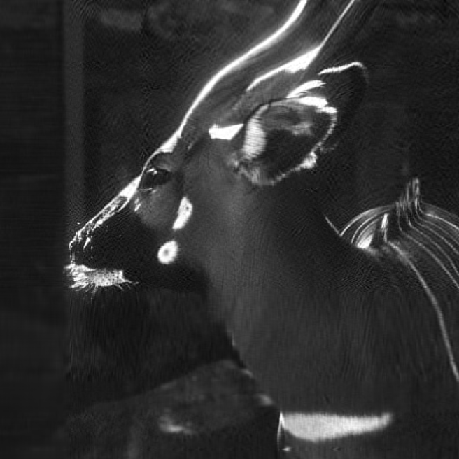
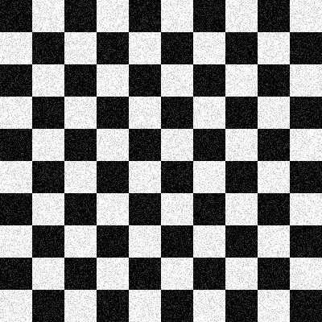
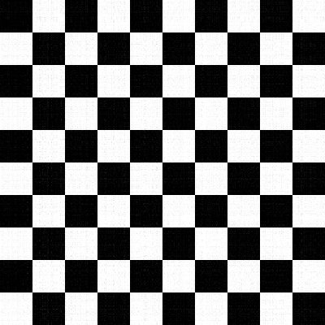
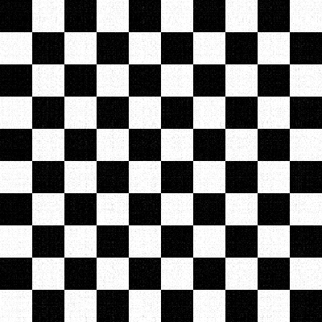

# SVD-Based Image Compression & Denoising

**Numerical Linear Algebra · C++ · Eigen · LIS**  
**Developed at ATSK**

A numerical computing project exploring how **singular value decomposition (SVD)** can be used to approximate grayscale images with lower-rank matrices and suppress noise while preserving the most significant image features.

The implementation uses **C++17** and the **Eigen** linear algebra library for matrix operations, eigenvalue analysis, and truncated SVD. It also integrates a **LIS** eigensolver to investigate iterative methods and spectral shifts.

## Overview

A grayscale image can be represented as a matrix $A \in \mathbb{R}^{m \times n}$, where each entry describes a pixel intensity. Its singular value decomposition is

$$
A = U\Sigma V^T.
$$

By retaining only the largest $k$ singular values, we obtain a rank-$k$ approximation:

$$
A_k = U_k\Sigma_k V_k^T = CD^T,
$$

where $C = U_k$ and $D = V_k\Sigma_k$. This representation uses $k(m+n)$ scalar entries instead of $mn$ for the full image matrix, when the factors are stored explicitly.

The same technique can help remove noise: significant image structure is often concentrated in the dominant singular components, whereas smaller components may capture noise and fine-scale variation.

> **Scope:** This is a demonstration of low-rank matrix approximation, not a production image codec. The program reconstructs and exports PNG files; it does not implement a custom compressed-file format.

## Features

- Load a grayscale image and convert its pixel values to an Eigen matrix.
- Analyze the spectrum of $A^T A$ with Eigen's `SelfAdjointEigenSolver`.
- Export $A^T A$ in **Matrix Market** format.
- Compute its dominant eigenvalue using a **LIS** iterative eigensolver, including an experiment with a spectral shift.
- Compute an SVD with Eigen's `BDCSVD`.
- Reconstruct a photograph using truncated SVD at ranks **30** and **90**.
- Generate a **400 × 400** checkerboard, add random pixel-intensity noise in the range **[-60, 60]**, and reconstruct it at ranks **6** and **12**.
- Export reconstructed images as grayscale PNG files.

## Results

### 1. Image compression

The original input is a **656 × 656** grayscale image. Lower-rank reconstructions illustrate the balance between representation size and visual fidelity.

| Original | Rank 30 | Rank 90 |
|:---:|:---:|:---:|
|  |  |  |

For a 656 × 656 matrix, the factorized representations contain:

| Representation | Stored scalar entries | Relative to original matrix |
|---|---:|---:|
| Full matrix | 430,336 | 100% |
| Rank 30: `C` + `D` | 39,360 | ~9.1% |
| Rank 90: `C` + `D` | 118,080 | ~27.4% |

These are **matrix-entry counts**, not measured PNG file sizes or end-to-end compression ratios.

### 2. Noise reduction

A synthetic checkerboard provides a controlled example of how truncated SVD handles noise.

| Original | Noisy |
|:---:|:---:|
|  |  |

| Rank 6 reconstruction | Rank 12 reconstruction |
|:---:|:---:|
|  |  |

Smaller ranks retain the strongest structural components and can filter out more noise. Increasing the rank preserves additional detail but may also reintroduce some noise. The best rank therefore depends on the desired trade-off.

### 3. Spectral analysis

Reference results for the supplied photograph include:

| Quantity | Result |
|---|---:|
| Largest singular value, $\sigma_1$ | ~135.863 |
| Second singular value, $\sigma_2$ | ~41.6618 |
| Dominant eigenvalue of $A^TA$, $\lambda_1$ | ~18,458.84 |
| Shift tested with the LIS eigensolver | 867.85 |
| Iterations reported for the shifted run | 9 |

As expected, $\lambda_1 = \sigma_1^2$ up to numerical precision. The shifted iteration experiment used a tolerance of $10^{-10}$; iteration counts can depend on the solver build and environment.

## Tech stack

- **Language:** C++17
- **Linear algebra:** Eigen (`SelfAdjointEigenSolver`, `BDCSVD`)
- **Iterative eigenvalue computation:** LIS (`eigen1`)
- **Image I/O:** `stb_image` and `stb_image_write`
- **Build system:** GNU Make and `g++`

## Build and run

Run the following commands **from the `challenge_2` directory**:

```bash
cd challenge_2
make mkEigenInc=/usr/include/eigen3
make run
```

If Eigen is installed elsewhere, replace `/usr/include/eigen3` with the directory containing its `Eigen/` headers.

By default, the executable loads `res/deer.jpg`. You can choose another grayscale image using:

```bash
./build/main path/to/image.jpg
```

**LIS requirement:** The program calls `res/eigen1` to perform the iterative eigenvalue calculations. The repository includes a prebuilt executable, but it is environment-specific and may not work on another machine. For a portable setup, build the LIS example executable for your own system and place it at `res/eigen1`, or adapt those calls in `src/main.cpp`. The current program stops if either LIS command fails.

Generated images are written into `res/`. The Matrix Market export is saved as `res/ATA.mtx`.

## Project structure

```text
challenge_2/
├── src/
│   └── main.cpp          # Numerical analysis and image processing
├── include/
│   ├── stb_image.h       # Image loading
│   └── stb_image_write.h # PNG output
├── res/
│   ├── deer.jpg          # Original image
│   ├── A30.png           # Rank-30 reconstruction
│   ├── A90.png           # Rank-90 reconstruction
│   ├── checkboard.png    # Original checkerboard
│   ├── checknoisy.png    # Noisy checkerboard
│   ├── check6.png        # Rank-6 reconstruction
│   ├── check12.png       # Rank-12 reconstruction
│   └── eigen1            # LIS example executable (platform-specific)
├── Makefile
└── README.md
```

## Key takeaways

This project demonstrates the practical relationship between **eigenvalues, singular values, low-rank approximation, and image processing**. It also highlights the impact of rank selection on reconstruction quality and the usefulness of iterative eigensolvers for spectral computations.
